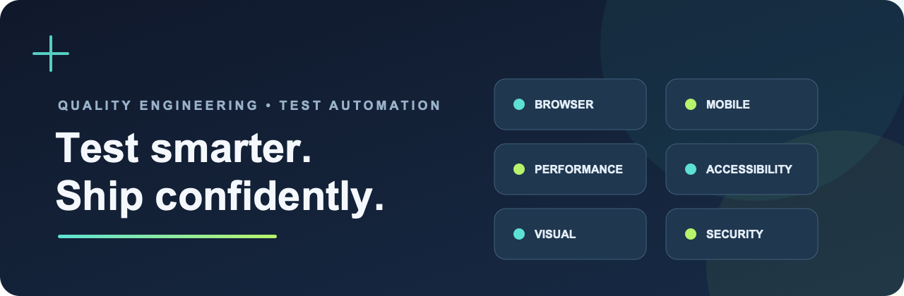

<h1 align="center">Code Craft Automation Lab</h1>

<div align="center">
  
</div>

<div align="center">
  <strong>A hands-on lab for quality engineering and test automation.</strong><br>
  Browser • Mobile • Performance • Accessibility • Visual • Security
</div>

<br>

<div align="center">
  <a href="https://github.com/Akanksha-099/code-craft-automation-lab/actions/workflows/cypress-tests.yml"></a>
  <a href="https://github.com/Akanksha-099/code-craft-automation-lab/actions/workflows/lighthouse-tests.yml"></a>
  <a href="https://github.com/Akanksha-099/code-craft-automation-lab/actions/workflows/performance-tests.yml"></a>
  <a href="https://github.com/Akanksha-099/code-craft-automation-lab/actions/workflows/html-validation.yml"></a>
</div>

<details>
  <summary>More workflow checks</summary>
  <br>
  <a href="https://github.com/Akanksha-099/code-craft-automation-lab/actions/workflows/page-load-time.yml"></a>
  <a href="https://github.com/Akanksha-099/code-craft-automation-lab/actions/workflows/backstop.yml?query=branch%3Aupdate-backstop-test"></a>
  <a href="https://github.com/Akanksha-099/code-craft-automation-lab/actions/workflows/owasp-zap-baseline-scan.yml"></a>
  <a href="https://github.com/Akanksha-099/code-craft-automation-lab/actions/workflows/appium.yml"></a>
</details>

Code Craft Automation Lab brings together browser and mobile testing, performance and accessibility audits, HTML validation, visual regression, and baseline security scanning. Examples run locally and through GitHub Actions, with selected reports published to GitHub Pages.

**[Explore the latest reports](#reports)** · **[Get started](#getting-started)** · **[Contribute](CONTRIBUTING.md)**

## Contents

- [Toolset](#toolset)
- [GitHub Actions](#github-actions)
- [Getting Started](#getting-started)
- [Reports](#reports)
- [Contributing](CONTRIBUTING.md)

## Toolset

| Tool | Purpose |
| --- | --- |
| Cypress | Browser end-to-end tests with HTML reports, videos, and a Cypress-generated page-load report |
| Lighthouse | Accessibility and performance audits with configured score thresholds; scores are posted as commit comments on pushes |
| K6 | HTTP performance testing with detailed and summary HTML reports |
| Appium and WebdriverIO | Android device tests executed through BrowserStack |
| HTML Validator | HTML conformance checks using default and WHATWG validator configurations |
| Page Load Time | Timestamped load-time measurements, JSON data, and an HTML report |
| BackstopJS | Visual regression comparisons using phone and tablet viewport profiles |
| OWASP ZAP | Baseline security scanning of a configured or manually supplied target |

## GitHub Actions

| Workflow | Triggers | Output |
| --- | --- | --- |
| Cypress Tests | Push to `main`, weekly Monday schedule, or manual dispatch | Cypress report and videos; Cypress page-load report; reports deployed to GitHub Pages |
| Lighthouse Tests | Push to `main`, weekly Monday schedule, or manual dispatch | Lighthouse scores as commit comments on pushes; HTML reports uploaded as artifacts (2-day retention); score thresholds verified |
| K6 Performance | Push to `main`, weekly Monday schedule, or manual dispatch | HTML reports on GitHub Pages under `performance-reports/` |
| HTML Validation | Push to `main`, weekly Monday schedule, or manual dispatch | Validation report artifacts |
| Page Load Time | Push to `main`, weekly Monday schedule, or manual dispatch | Report on GitHub Pages under `page-load-times/` |
| BackstopJS | Push to `update-backstop-test`, weekly Monday at 00:00 UTC, or manual dispatch | Report on GitHub Pages under `backstop-reports/html/` |
| OWASP ZAP Baseline | Weekly Monday at 00:00 UTC or manual dispatch with an optional target URL | Report on GitHub Pages under `zap-baseline/`; scan reports are also uploaded as artifacts |
| Appium | Manual dispatch | BrowserStack run; failure logs artifact |

Scheduled workflows must be present on the repository's default branch. Backstop checks out `update-backstop-test` for its configuration and reference images. Its manual dispatch supports `test` and `approve` modes; approve mode updates the reference images.

### Slack Notifications

The Cypress, Lighthouse, K6, HTML validation, page-load, BackstopJS, OWASP ZAP, and Appium workflows send Slack status notifications. Configure `SLACK_CHANNEL_NAME`, `SLACK_USERNAME`, and `SLACK_WEBHOOK` as GitHub Actions repository secrets. Notifications run even when the test job fails, so the message reports the job result.

### QA Notes

- BackstopJS compares screenshots against reference images in `backstop_data/bitmaps_reference`. Review visual diffs before approving new references.
- Several workflows exercise external websites or hosted services. A target outage or site change can affect results independently of changes in this repository.
- On pushes, the Lighthouse workflow posts scores as a comment on the triggering commit. Lighthouse HTML reports are uploaded as workflow artifacts for two days; they are not committed to the repository or published to GitHub Pages.
- OWASP ZAP reports are published to GitHub Pages and may be public. Only scan authorized targets, and avoid sensitive target URLs.
- GitHub Actions artifacts expire according to each workflow's retention setting; GitHub Pages holds the latest published report at its stable URL.

## Getting Started

### Prerequisites

- Node.js and npm. Workflows use different Node.js versions; check each workflow for its runtime.
- Git.
- K6 CLI to run K6 scripts locally.
- A BrowserStack account and credentials for Appium tests.
- GitHub Actions secrets for integrations such as Slack and BrowserStack.

### Install

```sh
git clone https://github.com/Akanksha-099/code-craft-automation-lab.git
cd code-craft-automation-lab
npm ci
```

Do not commit credentials. Configure service credentials through environment variables or GitHub Actions secrets.

### Run Locally

```sh
# Cypress
npx cypress run

# Cypress in Chrome
npm run test:chrome

# BackstopJS visual comparison
npx backstop test

# Update BackstopJS reference images after reviewing visual changes
npx backstop reference

# K6 example
k6 run k6Tests/single-request.js

# Appium Android test
npx wdio run wdio.android.bs.conf.js --spec ./test/specs/android.ts

# HTML validation
node HTMLValidator/validator_default.js
node HTMLValidator/validator_WHATWG.js

# Page-load measurement
node PageLoadTime/loadtimes.js
```

The previous README listed `npm run k6Tests/<script-name>.js`. That command is not a configured npm script in this repository and will not run as written. Use the K6 CLI, for example `k6 run k6Tests/single-request.js`.

Lighthouse audits currently run through GitHub Actions.

## Reports

| Report | GitHub Pages location |
| --- | --- |
| Cypress | [`cypress-reports/html/latest-report.html`](https://Akanksha-099.github.io/code-craft-automation-lab/cypress-reports/html/latest-report.html) |
| Cypress page-load result | [`cypress-reports/page-load-times/latest-loadtimes.html`](https://Akanksha-099.github.io/code-craft-automation-lab/cypress-reports/page-load-times/latest-loadtimes.html) |
| K6 detailed | [`performance-reports/k6-detailed-latest.html`](https://Akanksha-099.github.io/code-craft-automation-lab/performance-reports/k6-detailed-latest.html) |
| K6 summary | [`performance-reports/k6-summary-latest.html`](https://Akanksha-099.github.io/code-craft-automation-lab/performance-reports/k6-summary-latest.html) |
| Page load time | [`page-load-times/latest-report.html`](https://Akanksha-099.github.io/code-craft-automation-lab/page-load-times/latest-report.html) |
| BackstopJS | [`backstop-reports/html/latest-report.html`](https://Akanksha-099.github.io/code-craft-automation-lab/backstop-reports/html/latest-report.html) |
| OWASP ZAP | [`zap-baseline/latest-report.html`](https://Akanksha-099.github.io/code-craft-automation-lab/zap-baseline/latest-report.html) |

Other outputs, including Lighthouse results, HTML validation reports, Cypress videos, and ZAP JSON/Markdown reports, are available as artifacts on their workflow runs. Artifact retention varies by workflow.

## Contributing

See [CONTRIBUTING.md](CONTRIBUTING.md) for setup and contribution guidelines.
